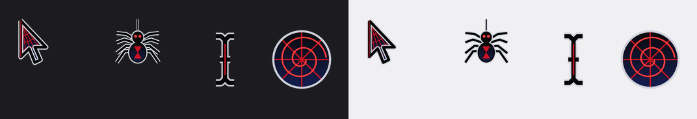

# WebSlinger

A dark red-and-black web theme for macOS: a custom cursor set, an RStudio editor theme with a
spider web in the corner, a matching Positron theme, and a script that tints app icons to match.



Open `preview.html` for real screenshots of the editor themes.

## What's inside

| Folder | What it is |
|---|---|
| `cursor/` | `WebSlinger.cape`: a web-pattern arrow, a hanging-spider link cursor, a text cursor and a spinning web loader, for [Mousecape](https://github.com/sdmj76/Mousecape-swiftUI) |
| `rstudio/` | `WebSlinger.rstheme`: near-black editor, crimson keywords, blue functions, and a faint web behind your code |
| `positron/` | `WebSlinger.vsix`: the same colours as a Positron (or VS Code) colour theme, covering the editor, panels and terminal |
| `icons/` | `tint_icons.py`: recolours app icons into the dark red style of the macOS Tinted Dock |

## Install the cursors

1. Install [Mousecape-swiftUI](https://github.com/sdmj76/Mousecape-swiftUI/releases) (works on macOS 14 to 26).
2. Double-click `cursor/WebSlinger.cape` to import it, select it and click Apply.
3. Leave the system pointer colour at its default (System Settings → Accessibility → Display →
   Pointer → Reset Color). A custom pointer colour stops Mousecape working outside the Dock.
4. Turn Mousecape on in System Settings → General → Login Items & Extensions → Allow in the
   Background. Otherwise its helper doesn't start after a restart and the normal cursor comes back.

## Install the RStudio theme

In the RStudio **Console**:

```r
rstudioapi::addTheme("path/to/rstudio/WebSlinger.rstheme", apply = TRUE)
```

Or: Tools → Global Options → Appearance → Add…, pick the file, then choose WebSlinger.

## Install the Positron theme

```bash
/Applications/Positron.app/Contents/Resources/app/bin/code --install-extension positron/WebSlinger.vsix
```

Or in Positron: Extensions → ⋯ → Install from VSIX…, pick the file. Then choose WebSlinger under
Preferences → Theme → Color Theme. After editing the JSON in `positron/themes/`, run
`positron/build_vsix.sh` to rebuild.

### Optional: the corner web in Positron

Colour themes can't draw images, so the web needs the open-source
[background](https://github.com/shalldie/vscode-background) extension (MIT). It works by editing
Positron's own files, so Positron will warn that its installation "appears to be corrupt" (safe to
dismiss), and you'll need to reload after each Positron update.

1. Install it: Extensions → search "background" by shalldie.
2. Copy the image: `mkdir -p ~/.config/webslinger && cp positron/web.png ~/.config/webslinger/`
3. Add the settings below to Positron's `settings.json` (⌘⇧P → "Preferences: Open User Settings
   (JSON)") and click "Apply and Reload" when the extension asks.
4. Run `python3 positron/fix_background_nonce.py`, then quit and reopen Positron. Positron's security
   policy blocks the extension's script otherwise. Re-run it after changing `background.*` settings or
   updating Positron.

```json
"background.editor": {
  "useFront": true,
  "images": ["~/.config/webslinger/web.png"],
  "style": {
    "background-position": "right top",
    "background-size": "420px 420px",
    "background-repeat": "no-repeat",
    "opacity": 1
  }
}
```

The web shows in code editors (`.R`, `.py`, and `.qmd` in Source mode). It does not show in the Quarto
Visual Editor, which is a separate embedded page the extension can't draw on.

To remove it cleanly, click "Background" in the status bar and choose "Uninstall the extension." before
removing it from Extensions; that puts Positron's files back.
`positron/make_web_png.py` rebuilds `web.png` from the same geometry as the RStudio web.

## Tint an app icon

Needs Python 3 with Pillow (`pip install pillow`). Export the app's icon to
`icons/app_icons/<name>_orig.png`, then run from the `icons` folder:

```bash
python3 tint_icons.py <name>
```

It writes `app_icons/<name>_red.png`. Set it on the app with Get Info: select the app, press ⌘I,
click the small icon at the top left and paste the image.

## Rebuild from source

Each output is generated by the script next to it, so you can change colours or sizes and rebuild:

```bash
cd cursor && python3 make_cape.py        # cursors (needs Pillow)
cd rstudio && python3 make_rstheme.py    # RStudio theme (reads RStudio's bundled Tomorrow Night)
```

## License

MIT, see `LICENSE`. The RStudio theme is a recolour of Tomorrow Night; see `NOTICE.md`.
